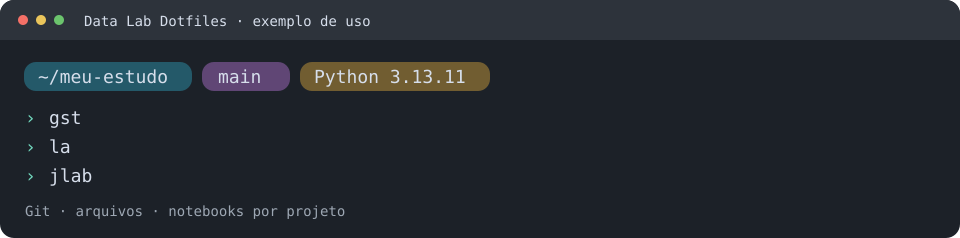

# Data Lab Dotfiles

Dotfiles e ferramentas de terminal para trabalhar com ciência de dados no Linux.
O projeto configura Zsh, Bash, Nushell e ferramentas de navegação, busca e
desenvolvimento. A CLI `devshell` apresenta as alterações antes da aplicação e
mantém backups das configurações gerenciadas. Bibliotecas científicas ficam em
ambientes próprios de cada projeto.



A imagem ilustra o uso; a aparência depende da fonte e do emulador de terminal.

[Instalação rápida](#instalação-rápida) · [Perfis](#perfis) ·
[Primeiros comandos](#primeiros-comandos) · [Projetos Python](#projetos-python) · [Glossário](#glossário-rápido) ·
[Manuais](#manuais) · [Licença](#licença)

## O que você recebe

- Terminal com prompt Starship, completamento, histórico e dois plugins Zsh.
- Atalhos para listar arquivos, pesquisar, navegar e consultar repositórios Git.
- Interpretadores Python e ferramentas isoladas via uv, com exemplos científicos
  em Python e R para copiar para seus próprios projetos.
- Planejamento, diagnóstico e recuperação de dotfiles pela CLI `devshell`.
- Lançador opcional `devshell` no PATH, com instalação local, revisão e backup.
- Gerador `pyinit` para criar projetos e manter os existentes, com sincronização
  e autorização direnv solicitadas explicitamente.
- Diagnóstico de `.venv` e reparo revisado de permissões com `project doctor`
  e `project fix-permissions`; veja o [guia de uso](docs/USAGE.md#diagnosticar-e-reparar-permissões-de-uma-venv).

Os indicadores de R, Java, Rust, Go, Node.js, JavaScript, TypeScript, Quarto e
Astro no prompt reconhecem o contexto do diretório. Eles não instalam essas linguagens ou projetos.
JupyterLab, bibliotecas científicas e renv dependem da preparação de cada estudo;
veja o [guia científico](docs/SCIENCE.md).

## Requisitos e plataformas

Para iniciar: Linux, Bash >=4.4, Python >=3.11 e utilitários GNU básicos.
A [lista de pré-requisitos por funcionalidade](docs/INSTALLATION.md#pré-requisitos-por-funcionalidade)
separa o mínimo para iniciar, o terminal completo, runtimes e testes.
O setup pode instalar componentes ausentes de usuário e apresentar pacotes da
distribuição. Downloads exigem rede; pacotes administrativos exigem autorização.
Chezmoi é necessário para aplicar a configuração e pode ser instalado pelo setup.

Há verificação local em Ubuntu 26.04 x86_64/glibc. A matriz histórica de
containers cobre Ubuntu 24.04, Debian 13, Fedora 44, Arch e openSUSE Leap 16.0;
ela não foi repetida para as últimas alterações nem comprova a instalação de
todos os pacotes dos perfis em cada distribuição.
Consulte o [alcance da validação](docs/VALIDATION.md) antes de usar em outra
plataforma. Esta é uma versão experimental.

## Instalação rápida

Clone o repositório público e entre na raiz. Você também pode baixar o ZIP
pelo botão **Code**, extrair e abrir a pasta que contém `bootstrap.sh`.
Para terminal e ciência de dados:

```bash
git clone --recurse-submodules https://github.com/talesgomes27/data-lab-dotfiles.git
cd data-lab-dotfiles
./bin/devshell setup --profile personal,science --dry-run
./bin/devshell setup --profile personal,science
./bin/devshell doctor --profile personal,science
```

O primeiro comando inspeciona. O segundo apresenta permissões, pacotes,
componentes de usuário e alterações nos arquivos, com confirmações separadas.
Conflitos exigem revisão do diff e a palavra `substituir`. O setup termina com
`doctor`; retorno zero indica que as verificações do perfil passaram.

Para incluir btop, ncdu, tldr e Lazygit, use `personal,science,extras` **nos três
comandos**. Mantenha a mesma seleção nas verificações e atualizações futuras.
A disponibilidade dos pacotes varia por versão da distribuição.

Depois, inicie `zsh` ou abra outro terminal se ela já for sua shell de login.
Selecione **FiraCode Nerd Font Mono** nas preferências do emulador para os ícones.
O setup não troca a shell de login; essa escolha é [manual e opcional](docs/INSTALLATION.md#primeiro-acesso).

A [instalação detalhada](docs/INSTALLATION.md) explica requisitos, confirmações,
Bash, operação manual, offline e atualização de ferramentas.

## Perfis

Todos os perfis incluem `minimal`. Os nomes podem ser combinados por vírgulas.

| Perfil | Finalidade e componentes |
|---|---|
| `minimal` | Base: Bash, Zsh, Git, uv e Chezmoi. |
| `personal` | Terminal: Nushell, Starship, fzf, zoxide, direnv, ripgrep, fd, bat, eza, Delta, plugins Zsh e FiraCode Nerd Font. |
| `science` | Python gerenciado, gerador `pyinit`, Ruff, pre-commit, IPython, ShellCheck, shfmt e Bats. Inspeciona DuckDB CLI opcional; bibliotecas científicas ficam por projeto. |
| `work` | Base com ripgrep e ShellCheck, sem os hooks opcionais de `personal`. |
| `extras` | Complementos opcionais: btop, ncdu, tldr/tealdeer e Lazygit. |

`work,personal` habilita as integrações de `personal`. Componentes de perfis
anteriores não são desinstalados ao mudar a seleção.

## Primeiros comandos

Para chamar a CLI de qualquer pasta, instale opcionalmente o
[lançador local `devshell`](docs/INSTALLATION.md#disponibilizar-devshell-no-path)
em `~/.local/bin`. Na raiz do checkout:

```bash
./bin/devshell install --component devshell --offline
# Revise o plano e substitua HASH_REVISADO pelo hash exibido:
./bin/devshell install --component devshell --offline --approve HASH_REVISADO
```

Esse componente é instalado separadamente do setup e dos perfis, sem downloads.
Com `~/.local/bin` no PATH, `devshell` funciona de qualquer pasta e `pyinit`
encontra a CLI sem `DEVSHELL_BIN`. O lançador aponta para o checkout original;
mantenha essa cópia no mesmo caminho ou revise sua reinstalação após movê-la.

Em uma nova sessão Zsh, depois de aplicar `personal`:

| Tarefa | Comando ou atalho |
|---|---|
| Listar em grade / incluir ocultos | `l` / `la` |
| Listar detalhes / incluir ocultos | `ll` / `lla` |
| Ver árvore de dois níveis / incluir ocultos | `lt` / `lta` |
| Retornar a uma pasta já visitada | `cd parte-do-nome` |
| Escolher uma pasta interativamente | `cdi parte-do-nome` |
| Procurar um comando anterior | Ctrl+R |
| Inserir um caminho com prévia | Ctrl+T |
| Consultar Git, dentro de um repositório | `gst` / `gl` |
| Ver o espaço usado até um nível | `du1` |

Os seis aliases de listagem também estão disponíveis no Bash pelo fragmento
compartilhado. Eles exibem ícones sempre; `ls` mantém ícones automáticos.
`l` passa a usar eza no lugar do atalho padrão do Ubuntu.

`jlab` exige um projeto uv com lock válido e grupo `notebook`; ele não funciona
em qualquer diretório. Siga o [exemplo científico](examples/science/README.md)
ou consulte o [diagnóstico do jlab](docs/TROUBLESHOOTING.md#jlab-sem-grupo-notebook).
O [manual de uso](docs/USAGE.md) apresenta exemplos e como sair das ferramentas.

## Projetos Python

O perfil `science` instala o gerador
[python-template-linux](https://github.com/talesgomes27/python-template-linux)
como `pyinit`, com commit e SHA-256 fixados no manifesto. Ele cria a `.venv`
e um `.envrc` compatível com Data Lab + direnv. Exemplo:

```bash
pyinit ../meu-projeto --archetype ds
```

Os arquétipos disponíveis são `universal`, `ds`, `api` e `cli`. Criar um
projeto pode baixar Python e dependências. O `.envrc` exige revisão e
autorização individual; o gerador não faz stage, commit ou push.

Para um projeto existente com `.venv`, entre na raiz e escolha a operação:

```bash
devshell project doctor
pyinit --fix-permissions
# Para acrescentar sync e autorização guiados:
pyinit --fix-permissions --sync --allow-direnv
```

O reparo apresenta os caminhos e modos antes de pedir confirmação e não usa
chmod recursivo. O sync pede confirmação própria, usa `--locked` quando há
lock e fica restrito à `.venv` local. A autorização mostra o `.envrc` completo,
pede outra confirmação e recusa arquivo inseguro ou alterado após a revisão.
Recusa ou falha impede as etapas seguintes. Esse modo não reinicializa o
projeto nem acrescenta dependências ao `pyproject.toml`. Consulte os
[pré-requisitos e limites da manutenção](docs/SCIENCE.md#manutenção-guiada-de-projetos-existentes).

A troca automática exige também a configuração do perfil `personal` e direnv.
Opcionalmente, prepare um [ambiente Python pessoal](docs/SCIENCE.md#ambiente-pessoal-e-troca-automática-por-projeto):
o terminal inicia em `geral`, usa a `.venv` dos projetos autorizados pelo direnv
e restaura o ambiente anterior ao sair. O preparo é explícito; a navegação não
instala pacotes.

Para migrar um projeto legado, a nova versão do gerador oferece diagnóstico
sem escrita e execução com plano, confirmação e backup:

```bash
pyinit /caminho/absoluto/projeto --migrate --dry-run
pyinit /caminho/absoluto/projeto --migrate --python 3.13.11
```

Reconhece requirements/pip-tools, Conda, Poetry, Pipenv, setuptools estático e
PEP 621/uv. Casos ambíguos bloqueiam; `direnv allow .` continua manual.
Confira os [formatos e limites](docs/SCIENCE.md#migrar-projetos-legados) e
`pyinit --help`: atualizar dotfiles não reinstala o gerador.

## Configuração, atualização e recuperação

As fontes ficam em `dotfiles/`. Zsh usa `~/.config/zsh` por meio de `~/.zshenv`;
Bash e Nushell têm integrações próprias. Personalizações particulares da
inicialização Zsh ficam na
[extensão `.zshenv.local`](docs/INSTALLATION.md#personalização-da-zshenv),
preservada fora dos arquivos gerenciados. [Veja os caminhos e a arquitetura](docs/ARCHITECTURE.md).
Para mudar a configuração, edite as fontes, confira `plan` e `diff` e use o setup
ou a aplicação manual aprovada. `update` atualiza somente configuração.
O gerador `pyinit` e o lançador têm instalações separadas: atualizar o clone
ou aplicar dotfiles não reinstala o `pyinit`. Siga o
[fluxo de atualização de ferramentas](docs/INSTALLATION.md#atualizar-configuração-e-versões)
para preservar instalações anteriores e revisar o novo plano.

Backups ficam em `~/.local/state/devshell/transactions` por padrão. `rollback`
restaura a última transação de dotfiles e recusa alterações posteriores; ele não
desinstala ferramentas. `rollback --list` mostra o histórico, e
`rollback --prune --keep N` remove backups antigos depois de aprovação, sem
volta. Leia [segurança e recuperação](docs/SECURITY.md) antes de restaurar ou
podar. Não aplique Chezmoi diretamente sobre a HOME usando estas fontes:
isso contornaria o journal da CLI.

## Glossário rápido

| Termo | Significado neste projeto |
|---|---|
| Dotfiles | Arquivos de configuração do terminal e das ferramentas do usuário. |
| Shell | Programa que interpreta comandos, como Zsh ou Bash. |
| Perfil | Conjunto declarativo de componentes selecionados pela CLI. |
| PATH | Lista de diretórios onde a shell procura executáveis. |
| XDG | Convenção para separar configuração, dados, cache e estado; o default de configuração é `~/.config`. |
| Ambiente virtual (`.venv`) | Ambiente Python com as dependências de um projeto. |
| Grupo de dependências | Conjunto nomeado de pacotes no `pyproject.toml`, como `notebook` ou `analytics`. |
| Lock | Arquivo que registra a resolução das dependências, como `uv.lock`. |
| Dry-run | Inspeção da operação sem aplicá-la. |
| Rollback | Restauração da última transação de dotfiles; não desfaz instalações. |

## Manuais

| Preciso de… | Documento |
|---|---|
| Instalar e escolher o modo de operação | [Instalação](docs/INSTALLATION.md) |
| Usar ferramentas e atalhos | [Uso cotidiano](docs/USAGE.md) |
| Preparar Python, Jupyter ou R | [Ciência de dados](docs/SCIENCE.md) |
| Resolver uma falha | [Diagnóstico](docs/TROUBLESHOOTING.md) |
| Entender backups e limites | [Segurança](docs/SECURITY.md) |
| Entender o funcionamento e as decisões | [Arquitetura](docs/ARCHITECTURE.md) e [ADRs](docs/ADR/README.md) |
| Conferir testes e compatibilidade | [Validação](docs/VALIDATION.md) |
| Contribuir ou preparar uma versão | [Contribuição](CONTRIBUTING.md) |

Fontes oficiais estão em [Referências](docs/REFERENCES.md); mudanças destinadas
aos usuários ficam no [Changelog](CHANGELOG.md). Para pedir ajuda, abra uma issue
com a mensagem de erro e a seleção de perfis, sem incluir credenciais ou arquivos
privados. Falhas de segurança têm [orientação própria](docs/SECURITY.md#relatar-uma-vulnerabilidade).

## Licença

Código e documentação do projeto estão sob a [licença MIT](LICENSE).
A atribuição histórica do projeto foi preservada. Ferramentas, plugins e fontes
de terceiros mantêm suas próprias licenças.
