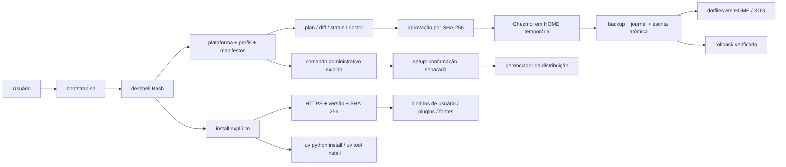

# Arquitetura

[Início](../README.md) · [Contribuição](../CONTRIBUTING.md) · [Decisões](ADR/README.md)

`bootstrap.sh` é POSIX sh e delega à CLI Bash. `bin/devshell` valida argumentos;
`lib/platform.sh` lê `/etc/os-release` sem `source`/eval, identifica arquitetura
normalizada e libc; `lib/profiles.sh` combina listas sem executar seu conteúdo.
`manifests/packages.tsv` traduz componentes para nomes por distribuição.

`lib/state.py` usa apenas a biblioteca padrão para relatórios JSON, hashing,
comparação, bloqueio, metadados e escrita atômica. Isso evita parsers JSON e
manipulação de nomes/permissões frágeis em shell. A orquestração e comandos de
uv ficam em Bash. Não há dependência pip para executar a CLI.

`.chezmoiroot` aponta para `dotfiles/`. Só fontes estáticas são aceitas: sem
externals, scripts de instalação ou templates executáveis. Chezmoi é executado
com HOME, cache, configuração e banco temporários; sua renderização deve
coincidir com os bytes aprovados antes da aplicação aos destinos reais. A
transação própria adiciona proteção contra conflitos e rollback, inclusive para
XDG fora da HOME. Não execute `chezmoi apply` diretamente contra a HOME usando
este repositório: isso contornaria a revisão e o journal da CLI.

Planos são calculados sem executar Chezmoi ou uv, sem rede, banco ou cache. Os
dotfiles estáticos permitem calcular seus bytes sem renderização. O hash inclui
perfis, conteúdo proposto, implementação/manifestos, metadados observados e
plataforma. Não é uma assinatura nem uma autorização permanente.

Arquivos compartilhados: `devshell/components` contém nomes de componentes;
Bash e Zsh compartilham `env.sh`, compatível com ambos, incluindo os aliases
ls/la para eza no perfil personal. `~/.bash_aliases` é um bootstrap específico
de Bash para carregar essa configuração pela convenção do Ubuntu. Nu lê a lista de
componentes e possui `env.nu`/`config.nu` próprios. Starship compartilha TOML.
Nenhuma shell tenta interpretar o código de outra.

O perfil `extras` oferece ferramentas de terminal por pacotes da distribuição;
disponibilidade varia por release e `-` continua exigindo instalação manual.
DuckDB é um componente opcional de `science`: seu status aparece no plano e no
doctor sem provocar instalação administrativa. Bibliotecas DuckDB, Polars e
PyArrow ficam no grupo opcional `analytics` do exemplo científico, com lock
próprio; JupyterLab fica no grupo `notebook` e pytest no grupo de desenvolvimento.

A `.zshenv` só define ZDOTDIR. `.zprofile` prepara o ambiente de login;
`.zshrc` faz completion, histórico local, prompt, plugins e hooks interativos.
O carregamento repetido de `.zshrc` e do fragmento Bash é protegido. Bibliotecas
Python importáveis não são plugins de shell; `.venv` é responsabilidade de cada
projeto. Starship reconhece o ambiente virtual; uv fornece completion nativa.

Perfis selecionam integrações; comandos ausentes não impedem a shell de abrir.
`work` desativa os hooks opcionais por ausência de componentes. Nenhum perfil
executa `direnv allow` ou configura whitelist de diretórios.

`setup` acrescenta coordenação em `lib/setup.sh` e inspeção/reparo em
`lib/setup.py`. Ele reaproveita os comandos públicos e as mesmas versões mínimas,
checagens de caminhos, hashes e transações. As permissões são enumeradas sem
seguir symlinks; reparos aprovados conferem device/inode/tipo/modo/UID/GID antes
de chmod via descritor, sem recursão. Não há modo de aprovação irrestrita.

O fluxo guiado tem confirmações separadas para permissões, comando
administrativo, componentes e aplicação. Conflitos exigem a palavra
`substituir`. Uma aprovação de arquivos é usada como foi apresentada; a
orquestração não gera outro hash para contornar alteração concorrente.

Códigos de saída: 0 sucesso/plano; 2 entrada inválida, conflito ou operação
recusada; 3 pré-requisito ausente ou problemas em doctor. Ferramentas uv e gerenciadores de pacotes podem
propagar seu próprio código de falha. Cancelamento do setup retorna 1. JSON vai para stdout; erros/progresso para
stderr. `diff --json` retorna hashes/ações; sem JSON mostra o diff unificado.

## Onde manter cada informação

`dotfiles/` contém as fontes estáticas; `profiles/` seleciona componentes;
`manifests/` declara pacotes, versões e checksums. Os exemplos em `examples/`
têm ambientes próprios. Os testes e os scripts de verificação ficam em `tests/`
e `scripts/`. Consulte o [guia de contribuição](../CONTRIBUTING.md) para validar
mudanças e a [instalação](INSTALLATION.md) para operar a CLI.

O README apresenta o projeto; os guias de instalação, uso, ciência e diagnóstico
são referências atuais. A validação resume evidências e limites; os ADRs guardam
as decisões adotadas. Planos concluídos e inventários particulares não fazem
parte do manual público.
