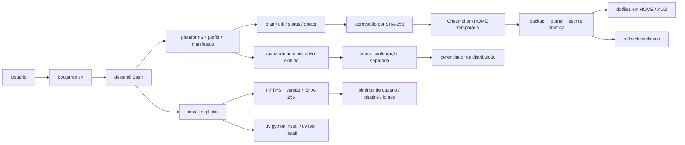

# Arquitetura

[Início](../README.md) · [Contribuição](../CONTRIBUTING.md) · [Decisões](ADR/README.md)

`bootstrap.sh` é POSIX sh e delega à CLI Bash. `bin/devshell` valida argumentos;
`lib/platform.sh` lê `/etc/os-release` sem `source`/eval, identifica arquitetura
normalizada e libc; `lib/profiles.sh` combina listas sem executar seu conteúdo.
`manifests/packages.tsv` traduz componentes para nomes por distribuição.

`lib/state.py` usa apenas a biblioteca padrão para relatórios JSON, hashing,
comparação, bloqueio, metadados e escrita atômica. Isso evita parsers JSON e
manipulação de nomes/permissões frágeis em shell. A orquestração e comandos de
uv ficam em Bash. Não há dependência pip para executar a CLI.

`.chezmoiroot` aponta para `dotfiles/`. Só fontes estáticas são aceitas: sem
externals, scripts de instalação ou templates executáveis. A conferência é uma
lista permitida, aplicada antes de executar Chezmoi: cada arquivo ou diretório
tem nome literal, opcionalmente com `dot_`, sem prefixos de atributo (`modify_`,
`create_`, `symlink_`, `run_`, `exact_` e afins), nomes `.chezmoi*` ou sufixos
`.tmpl`/`.literal`/`.age`/`.asc`. Chezmoi é executado
com HOME, cache, configuração e banco temporários; sua renderização deve
coincidir com os bytes aprovados antes da aplicação aos destinos reais. A
transação própria adiciona proteção contra conflitos e rollback, inclusive para
XDG fora da HOME. Não execute `chezmoi apply` diretamente contra a HOME usando
este repositório: isso contornaria a revisão e o journal da CLI.

Planos são calculados sem executar Chezmoi ou uv, sem rede, banco ou cache. Os
dotfiles estáticos permitem calcular seus bytes sem renderização. O hash inclui
perfis, conteúdo proposto, implementação/manifestos, metadados observados e
plataforma. Não é uma assinatura nem uma autorização permanente.

Arquivos compartilhados: `devshell/components` contém nomes de componentes;
Bash e Zsh compartilham `env.sh`, compatível com ambos, incluindo os aliases
ls/l/la/ll/lla/lt/lta para eza no perfil personal. `~/.bash_aliases` é um bootstrap
específico de Bash para carregar essa configuração pela convenção do Ubuntu. Nu lê a lista de
componentes e possui `env.nu`/`config.nu` próprios. Starship compartilha TOML.
Nenhuma shell tenta interpretar o código de outra.

O componente local opcional `install --component devshell` usa `lib/launcher.py`
para gerar somente `~/.local/bin/devshell` e seu registro privado. Reaproveita
snapshot, hash das fontes, bloqueio e escrita atômica de `lib/state.py`, sem
Chezmoi ou downloads. O caminho do checkout é escapado com `shlex.quote`;
o lançador executa a CLI original com `/bin/bash`, preservando argumentos e a
resolução de ROOT. Conflitos exigem `--replace-existing`; backups e journal
ficam separados em `launcher-backups`, sem alterar `current.json`/`latest`.
Doctor verifica o registro quando existente, sem executar o lançador.
Os perfis declarativos e os manifestos de artefatos permanecem independentes
desse componente local.

O perfil `science` inclui `pyinit`: o instalador de artefatos existente instala
somente o gerador standalone em `~/.local/bin`, com commit e SHA-256 fixados.
O submódulo `templates/python-template-linux` registra a fonte completa. Um teste
confere a correspondência entre gitlink, manifesto e bytes do script. Não há
atualização automática do submódulo, execução do gerador durante setup ou
`direnv allow` implícito. Doctor verifica integridade sem executar `pyinit`;
rollback de dotfiles não remove o script nem os projetos.

O perfil `extras` oferece ferramentas de terminal por pacotes da distribuição;
disponibilidade varia por release e `-` continua exigindo instalação manual.
DuckDB é um componente opcional de `science`: seu status aparece no plano e no
doctor sem provocar instalação administrativa. Bibliotecas DuckDB, Polars e
PyArrow ficam no grupo opcional `analytics` do exemplo científico, com lock
próprio; JupyterLab fica no grupo `notebook` e pytest no grupo de desenvolvimento.

A `.zshenv` define ZDOTDIR e pode carregar a extensão pessoal
`$ZDOTDIR/.zshenv.local`. O bootstrap usa somente builtins Zsh e `zsh/stat`,
sem Python, comandos externos, rede ou criação de diretórios. Valida arquivo
regular do usuário, link único, proprietários e permissões dos ancestrais;
symlinks, caminhos com `..` e escrita por grupo/outros são recusados. A exceção
sticky se limita a diretórios do sistema. A extensão é carregada no escopo global,
inclusive em shells não interativas, preservando `typeset` e exports pessoais.

O bootstrap gerenciado continua verificado integralmente por hash. O conteúdo
da extensão é particular, não gerenciado; doctor confere sua segurança sem
executá-la, setup apresenta problemas de permissões e rollback a preserva.
Arquivos `.zwc` correspondentes a `.zshenv`, `.zprofile`, `.zshrc` e à extensão
são sinalizados por doctor e bloqueiam setup: código compilado poderia
substituir o texto conferido. O bootstrap recusa carregar a extensão enquanto
houver seu `.zwc`, inclusive symlink quebrado. Isso não é uma sandbox para o
código pessoal nem proteção contra outro processo do mesmo UID.

`.zprofile` prepara o ambiente de login;
`.zshrc` faz completion, histórico local, prompt, plugins e hooks interativos.
O carregamento repetido de `.zshrc` e do fragmento Bash é protegido. Bibliotecas
Python importáveis não são plugins de shell; `.venv` é responsabilidade de cada
projeto. Starship reconhece o ambiente virtual; uv fornece completion nativa.

O ambiente pessoal opcional `geral` fica em
`$XDG_DATA_HOME/devshell/venvs/geral`, com fallback para `~/.local/share`.
Sua criação é manual; a seleção interativa exige componentes uv/direnv e
diretórios seguros. `safe-path.py --venv` também confere `pyvenv.cfg` regular
e executáveis python/python3, sem executá-los. Bash/Zsh selecionam pelo
`env.sh`; Nushell faz a seleção em `config.nu`. Ativações herdadas são
preservadas. O helper estático `direnv/lib/devshell-python.sh`, gerenciado
somente com o componente direnv, implementa `use devshell_python` em `.envrc`
autorizados. Retira o ambiente anterior do PATH antes de selecionar a `.venv`;
se ela faltar ou for insegura, mantém a retirada e avisa. Direnv restaura o
estado anterior ao sair, inclusive quando o terminal começa dentro do projeto.
Conda ativo é preservado, com aviso para desativação explícita antes da troca.
Nushell usa um hook `pre_prompt` que aplica também remoções de variáveis e
preserva o código de saída e o hook PWD de zoxide. Nada disso instala pacotes
ou altera ambientes durante abertura ou navegação.

Perfis selecionam integrações; comandos ausentes não impedem a shell de abrir.
`work` desativa os hooks opcionais por ausência de componentes. Nenhum perfil
executa `direnv allow` ou configura whitelist de diretórios.

`setup` acrescenta coordenação em `lib/setup.sh` e inspeção/reparo em
`lib/setup.py`. Ele reaproveita os comandos públicos e as mesmas versões mínimas,
checagens de caminhos, hashes e transações. As permissões são enumeradas sem
seguir symlinks; reparos aprovados conferem device/inode/tipo/modo/UID/GID antes
de chmod via descritor, sem recursão. Não há modo de aprovação irrestrita.

`project doctor` e `project fix-permissions` usam a inspeção pura do mesmo
`safe-path.py` instalado nas shells, sem executar o projeto. `--venv --explain`
conserva stdout reservado ao PATH e emite os motivos em stderr. Direnv mostra
os caminhos recusados, mantendo navegação sem instalações ou reparos.

Todos os comandos da CLI e os helpers das shells executam
`/usr/bin/python3` em modo isolado (`-I`, e `-B` na CLI): uma `.venv` ativa,
seus `.pth` ou o PYTHONPATH de um projeto não carregam código nas transações nem
na abertura das shells. Cada módulo de `lib/` importado por outro acrescenta somente o diretório `lib/`
ao `sys.path`.

`lib/project.py` usa esse mesmo Python isolado e importa apenas
a lib conhecida da CLI. Reaproveita o fingerprint das fontes e o chmod por
descritor de setup. A aprovação inclui o validador, os motivos e as identidades
observadas. Somente diretórios próprios dentro da HOME são reparáveis, sem
recursão. Symlinks, estrutura inválida e problemas no diretório do registro
bloqueiam a operação. Os modos anteriores ficam em registros privados de
`permission-repairs`; falha parcial preserva o histórico e os reparos concluídos.
Não há criação de ambientes, sincronização, autorização direnv ou restauração
automática de permissões inseguras.
Na confirmação interativa do reparo, a leitura consome somente uma linha sem
buffer antecipado, preservando respostas de etapas posteriores de um chamador
que componha esse comando por pipe. EOF, inclusive após resposta incompleta
sem Enter, cancela o reparo.

O fluxo guiado tem confirmações separadas para permissões, comando
administrativo, componentes e aplicação. Conflitos exigem a palavra
`substituir`. Uma aprovação de arquivos é usada como foi apresentada; a
orquestração não gera outro hash para contornar alteração concorrente.

O histórico de transações é lido por uma enumeração única em `lib/state.py`,
que classifica cada entrada sem lançar exceção: `rollback --list` mostra as
inválidas, e `rollback --prune` as recusa. A cadeia segue `previous_latest` a
partir de `latest`. A poda renomeia cada transação para `pruning/` antes de
apagá-la (descritor de diretório, sem seguir symlinks), de modo que o journal
só contém transações inteiras. O rollback só move `latest` para a transação
anterior se ela tiver manifesto legível.

Códigos de saída: 0 sucesso/plano; 2 entrada inválida, conflito ou operação
recusada; 3 pré-requisito ausente ou problemas em doctor. Ferramentas uv e gerenciadores de pacotes podem
propagar seu próprio código de falha. Cancelamento do setup retorna 1. JSON vai para stdout; erros/progresso para
stderr. `diff --json` retorna hashes/ações; sem JSON mostra o diff unificado.

## Onde manter cada informação

`dotfiles/` contém as fontes estáticas; `profiles/` seleciona componentes;
`manifests/` declara pacotes, versões e checksums. Os exemplos em `examples/`
têm ambientes próprios. Os testes e os scripts de verificação ficam em `tests/`
e `scripts/`. Consulte o [guia de contribuição](../CONTRIBUTING.md) para validar
mudanças e a [instalação](INSTALLATION.md) para operar a CLI.

O README apresenta o projeto; os guias de instalação, uso, ciência e diagnóstico
são referências atuais. A validação resume evidências e limites; os ADRs guardam
as decisões adotadas. Planos concluídos e inventários particulares não fazem
parte do manual público.
