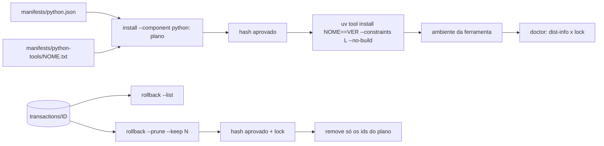

# Spec: histórico de transações, CI agendado e lock das ferramentas uv

## Contexto

A CLI `devshell` aplica dotfiles com journal e backup em
`$XDG_STATE_HOME/devshell/transactions/ID`, mas não mostra o histórico e nunca
apaga backups, que guardam cópias privadas dos dotfiles originais. A matriz de
containers e o smoke online só rodam por disparo manual. As ferramentas
Python (`manifests/python.json`) fixam a versão raiz, mas as dependências
transitivas são resolvidas a cada instalação, lacuna admitida em
`docs/SECURITY.md`. Público: quem mantém e usa o Data Lab em Linux.

Fatos observados (2026-11-09):

- Transações locais: 13, todas `committed`, numa cadeia linear por
  `previous_latest`, 144 KiB. Os manifestos têm `files`, `previous_latest`,
  `previous_registry` e `status`, sem data de criação.
- `uv tool install` (0.13.5) aceita `--constraints` e `--no-build`, mas não
  `--require-hashes`, que existe só em `uv pip`. Pela documentação do uv,
  hashes vindos de arquivos de constraints são regras de verificação ativas;
  isso ainda não foi provado na prática (Q-001).
- GitHub Actions: `schedule` usa cron POSIX em UTC, roda só na branch padrão,
  é desativado após 60 dias sem atividade em repositório público, e a
  notificação de falha vai para quem modificou o cron por último.

## Requisitos

**Histórico e poda de transações**

### R-001 Listar transações
- Enunciado: `devshell rollback --list` mostra todas as transações registradas.
- Critério: Dada uma HOME temporária com três aplicações seguidas e um rollback,
  Quando `rollback --list --json` roda, Então cada transação aparece com `id`,
  `status`, número de arquivos, `created` (ou `null` nas antigas) e posição na
  cadeia a partir de `latest` (`0` para a atual, `null` fora da cadeia), com
  saída 0. Sem transações, a saída é 0 com lista vazia. Nenhum arquivo ou
  diretório é criado (conferido com `find "$HOME"` antes e depois). Uma
  entrada inválida (diretório sem manifesto, manifesto ilegível, nome fora do
  padrão, symlink, temporário `.devshell-*`) aparece com `status: "invalida"`
  e o motivo, sem abortar a listagem.
- Prioridade: alta
- Estado: verificado
- Evidência: tests/history.bats::R-001 lista transações com status, cadeia e sem criar estado; tests/history.bats::R-001 entrada inválida aparece na listagem sem abortar; tests/history.bats::R-001 listagem marca symlink, nome inválido e temporário

### R-002 Data de criação nas novas transações
- Enunciado: transações novas registram a criação em UTC, ISO 8601.
- Critério: Dado um `apply` aprovado, Quando o manifesto é lido, Então contém
  `created` com fuso `Z`; manifestos antigos sem o campo continuam aceitos por
  `rollback`, `rollback --list` e `doctor`.
- Prioridade: média
- Estado: verificado
- Evidência: tests/history.bats::R-002 transação nova registra created em UTC; tests/history.bats::R-002 manifesto antigo sem created continua aceito; tests/history.bats::R-002 doctor aceita manifesto antigo sem created

### R-003 Plano de poda sem escrita
- Enunciado: `devshell rollback --prune --keep N` sem `--approve` mostra o
  plano e o hash de aprovação, sem alterar nada.
- Critério: Dadas cinco transações, Quando `rollback --prune --keep 2 --json`
  roda, Então lista três `delete` e duas `keep`, o total de bytes e `approval`
  (64 hex), avisa quando uma `delete` é a primeira transação da cadeia (a que
  guarda os dotfiles de antes do primeiro `apply`), com saída 0 e árvore de estado idêntica antes e depois (hash de
  todos os arquivos). `--keep` ausente, não inteiro ou menor que 1, `--keep`
  sem `--prune` e `--list` com `--prune` ou `--approve` saem com 2.
- Prioridade: alta
- Estado: verificado
- Evidência: tests/history.bats::R-003 plano de poda não altera o estado e avisa sobre os originais; tests/history.bats::R-003 combinações inválidas de opções saem com 2; tests/history.bats::R-003 dry-run descarta a aprovação; tests/history.bats::R-003 sem transação atual o plano avisa que remove todas

### R-004 Seleção conservadora
- Enunciado: a poda mantém `latest` e os N-1 antecessores na cadeia e marca
  para remoção as demais transações, inclusive as fora da cadeia.
- Critério: Dada uma transação com status fora de `committed`, `rolled-back`
  e `failed-restored` (inclusive `pending` e `rolling-back`), um manifesto
  ausente ou ilegível, um nome que não seja 32 hex, um symlink, ou um item que
  não seja `manifest.json` ou backup numerado regular dentro de uma transação,
  Quando a poda é planejada, Então sai com 2, nada é marcado e a mensagem
  aponta o procedimento manual do SECURITY. `latest` nunca é marcada.
- Prioridade: alta
- Estado: verificado
- Evidência: tests/history.bats::R-004 transação interrompida ou status desconhecido bloqueiam a poda; tests/history.bats::R-004 interrompida fora da cadeia não sugere rollback; tests/history.bats::R-004 entradas inválidas bloqueiam a poda sem alterar o estado; tests/test_boundaries.py::TransactionHistory.test_r004_pruning_never_follows_symlink_inside_transaction

### R-005 Poda aprovada
- Enunciado: com `--approve HASH`, a CLI replaneja sob o lock e remove só os
  diretórios do plano.
- Critério: Dado o hash do plano, Quando a poda roda, Então os diretórios
  `delete` deixam de existir, os `keep` e os demais arquivos de estado ficam
  byte a byte iguais, e a saída é 0. Com hash divergente ou estado alterado
  entre plano e execução, sai com 2 sem remover nada. Sob o lock, cada
  `delete`, da mais antiga para a mais nova, é renomeada para
  `devshell/pruning/ID` antes de ter o conteúdo removido, sem seguir symlinks.
  Dada uma falha injetada no meio, `transactions/` só contém transações
  inteiras, `rollback` e `apply` continuam funcionando, e a poda seguinte
  conclui a limpeza de `pruning/`.
- Prioridade: alta
- Estado: verificado
- Evidência: tests/history.bats::R-005 poda aprovada remove só o plano e preserva o restante; tests/history.bats::R-005 aprovação vencida não remove nada; tests/test_boundaries.py::TransactionHistory.test_r005_interrupted_prune_leaves_only_whole_transactions

### R-006 Rollback após poda
- Enunciado: desfazer a transação mais antiga mantida não deixa `latest`
  apontando para uma transação podada.
- Critério: Dada uma poda com `--keep 1`, Quando `rollback --approve HASH`
  restaura a transação mantida, Então `latest` deixa de existir (o anterior só
  vira `latest` se tiver `manifest.json` legível), o próximo
  `rollback` responde "Nenhuma transação para restaurar." com saída 0, e
  `apply` seguinte funciona.
- Prioridade: alta
- Estado: verificado
- Evidência: tests/history.bats::R-006 rollback da última transação mantida limpa latest e apply segue; tests/test_boundaries.py::TransactionHistory.test_r006_rollback_does_not_point_latest_to_unreadable_manifest

**CI agendado**

### R-010 Execução semanal completa
- Enunciado: o workflow `Verificações` roda toda semana com a mesma cobertura
  do disparo manual.
- Critério: Dado o workflow na `main`, Quando o evento `schedule` dispara
  (segunda 09:17 UTC), Então rodam `checks` com os cenários opcionais e a
  exigência de zero skips, os cinco `containers` e `online-smoke`. Verificação
  local: um teste lê `.github/workflows/ci.yml` como texto e confere o `cron` e
  que toda condição `workflow_dispatch` também aceita `schedule`. Verificação
  remota: a primeira execução agendada ou um disparo manual após o merge.
- Prioridade: média
- Estado: aprovado
- Evidência: (preenchida na entrega)

**Lock das ferramentas uv**

### R-020 Constraints com hash por ferramenta
- Enunciado: cada ferramenta de `manifests/python.json` tem
  `manifests/python-tools/NOME.txt` com todas as dependências fixadas por `==`
  e ao menos um `--hash=sha256:`, incluindo a própria ferramenta na versão do
  manifesto.
- Critério: Dado o perfil `science` e um arquivo ausente, um requisito sem
  `==`, sem hash sha256, ou a versão da ferramenta diferente da do manifesto,
  Quando `install --component python` planeja, Então sai com 2 e nada é
  instalado. O leitor junta continuações com `\`, ignora comentários e linhas
  vazias, e guarda o marcador de ambiente (`; ...`) sem avaliá-lo. Sem
  `python-tools` nos componentes, nenhum lock é exigido.
- Prioridade: alta
- Estado: aprovado
- Evidência: (preenchida na entrega)

### R-021 Instalação restrita ao lock
- Enunciado: `install --component python` passa `--constraints ARQUIVO
  --no-build` a cada `uv tool install`.
- Critério: Dado o plano, Quando é exibido, Então cada comando de ferramenta
  contém o caminho do arquivo de constraints e `--no-build`, e o hash de
  aprovação muda quando o arquivo muda (ele está em `manifests/`, coberto por
  `source_sha256`). Com ferramentas no plano, `check()` exige o uv na versão
  provada em R-022 ou superior.
- Prioridade: alta
- Estado: aprovado
- Evidência: (preenchida na entrega)

### R-022 Hash divergente recusado
- Enunciado: o uv recusa um artefato cujo hash difere do lock.
- Critério: Dados dois wheels locais construídos no teste, A dependendo de B,
  servidos com `--find-links`, `--no-index` e `--offline`, com o Python do
  sistema (`--python "$(command -v python3)"`, sem Python gerenciado), Quando
  `uv tool install A` roda com constraints em que o hash de B está errado,
  Então falha com mensagem de divergência de hash e `UV_TOOL_DIR/A` não existe;
  com os hashes certos, instala. O teste também registra o que acontece ao
  reinstalar com constraints uma ferramenta já instalada sem elas e ao resolver
  um pacote ausente do lock. Se o hash errado instalar, a tarefa para e PC-3 é
  reaberto (D-008).
- Prioridade: alta
- Estado: aprovado
- Evidência: (preenchida na entrega)

### R-023 Doctor detecta ferramenta fora do lock
- Enunciado: `doctor` compara as distribuições instaladas no ambiente de cada
  ferramenta com o arquivo de constraints.
- Critério: Dado um ambiente de ferramenta com uma dependência em versão
  diferente do lock, ou com uma distribuição que não aparece no lock, Quando
  `doctor --profile science` roda, Então há o diagnóstico "ferramenta uv fora
  do lock: NOME (DIST VERSÃO, lock VERSÃO)" e saída 3; a CLI não reinstala nem
  usa `--force`. Nomes são comparados normalizados (PEP 503); uma linha do lock
  sem distribuição instalada não gera alerta, porque pode ser de outra
  plataforma.
- Prioridade: média
- Estado: aprovado
- Evidência: (preenchida na entrega)

### R-024 Smoke online com lock
- Enunciado: o smoke online instala as ferramentas com os arquivos de lock.
- Critério: Dado `scripts/online-smoke.sh` no CI, Quando roda, Então ruff,
  pre-commit e ipython instalam com `--constraints`, a saída de `doctor` não
  contém "fora do lock", e o Ruff de `scripts/ci-setup.sh` também é instalado
  com o lock.
- Prioridade: média
- Estado: aprovado
- Evidência: (preenchida na entrega)

**Documentação**

### R-030 Documentação fiel
- Enunciado: USAGE, SECURITY, ARCHITECTURE, CONTRIBUTING, CHANGELOG e
  VALIDATION descrevem os comandos, a irreversibilidade da poda, o
  agendamento e o lock, com os limites.
- Critério: Dado o diff final, Quando revisado, Então cada flag nova aparece em
  `devshell --help` e na USAGE com exemplo executado, a tabela de recuperação
  do SECURITY inclui a poda, CONTRIBUTING traz o comando de regeneração do lock
  e o ADR 004 registra D-007/D-008.
- Prioridade: média
- Estado: aprovado
- Evidência: (preenchida na entrega)

## Fora do escopo

### N-001 Poda de `launcher-backups`, `permission-repairs`, `manual-backups` e `user-config-backups`
### N-002 Poda automática ou por idade, sem aprovação
### N-003 Reinstalação automática ou `--force` de ferramentas fora do lock
### N-004 Lock do próprio uv, do Chezmoi ou do Nushell (já fixados por SHA-256 em `artifacts.json`)
### N-005 Revisão assistida de manifestos, Quarto, desinstalação e Git gerenciado (itens 5 a 9 da conversa)
### N-006 Alerta por canal além da notificação padrão do GitHub

## Decisões

### D-001 Flags no comando `rollback`
`--list` e `--prune --keep N` ficam em `rollback`, que já é dono do journal.
`bin/devshell` aceita `--list`, `--prune` e `--keep` só em `rollback`. Evita
um subcomando novo e reaproveita `latest_transaction`, `locked` e `safe_path`
de `lib/state.py`.

### D-002 `--keep` obrigatório
Sem valor padrão: a quantidade a manter é escolha explícita, porque a poda é
irreversível. `latest` é sempre mantida, então `--keep 1` é o mínimo.

### D-003 Hash de aprovação da poda
O hash cobre o conteúdo de `latest`, o valor de N e, para cada transação, id,
status, decisão (`keep`/`delete`) e o SHA-256 e tamanho de cada arquivo. Qualquer mudança entre plano e
execução invalida a aprovação, como em `apply` e `rollback`.

### D-004 Rollback na borda do histórico
Em `rollback`, `latest` só passa a `previous_latest` se essa transação tiver
`manifest.json` legível; senão `latest` é removido. Não reescreve manifestos (o journal não é editado).

### D-009 Poda por renomeação
Cada transação a remover sai primeiro de `transactions/` por `os.rename` para
`devshell/pruning/ID`, no mesmo sistema de arquivos, e só então tem o conteúdo
apagado com `dir_fd` e `O_NOFOLLOW`. Uma interrupção deixa resto apenas em
`pruning/`, que nenhum leitor do journal consulta e que a poda seguinte limpa.

### D-010 Piso do uv acompanha a prova
Com ferramentas e locks no plano, `check()` exige o uv na versão em que R-022
foi provado (hoje 0.13.5), porque a verificação de hash depende dele.

### D-005 `created` opcional
Novos manifestos ganham `created`; leitores tratam ausência como `null`. O
campo não entra no hash do plano de `apply`.

### D-006 Cron semanal fora da hora cheia
`17 9 * * 1` (segunda, 09:17 UTC, 06:17 em Brasília), longe do início da hora,
quando o GitHub atrasa ou descarta execuções. As condições dos jobs passam a
`github.event_name == 'workflow_dispatch' || github.event_name == 'schedule'`.

### D-007 Um arquivo de constraints com hash por ferramenta
Gerado na revisão de manifesto com
`uv pip compile --universal --python-version 3.13 --generate-hashes`, a partir
de `NOME==VERSÃO`, com `uv --no-config`, `--index-url https://pypi.org/simple`
e `--no-python-downloads`, e versionado em `manifests/python-tools/`.
`--python-version` é o `tool_python` de `manifests/python.json` em minor. Um arquivo por
ferramenta evita conflito de dependências entre ferramentas. `--no-build`
impede compilar sdists, cujas dependências de build não teriam hash. Fica
registrado no ADR 004.

### D-008 Plano B se o uv não verificar os hashes
Se R-022 mostrar que `uv tool install` ignora os hashes das constraints, a
alternativa é criar o ambiente com `uv venv` e `uv pip install --require-hashes`
e expor os executáveis, o que troca os recibos do `uv tool` e muda o doctor.
Essa troca reabre PC-3 com o usuário antes de implementar.

## Restrições

- `rollback --list`, o plano de poda e `--dry-run` não criam estado (AGENTS.md).
- Poda e lock seguem aprovação por hash, sem `--yes`, e o `setup` não as aciona.
- Testes em HOME/XDG/cache temporários, sem rede; o que exige rede fica no
  smoke online ou na matriz.
- Atualizar versões ou hashes é revisão de manifesto com fonte oficial (PyPI).

## Questões abertas

### Q-001 O `uv tool install` aplica os hashes do arquivo de constraints?
Resolvida por R-022 (T-201), antes de qualquer outra tarefa do lock.

### Q-002 Todas as dependências têm wheel para x86_64 e aarch64, glibc e musl?
Resolvida ao gerar os arquivos (T-202), conferindo os hashes do lock contra os
wheels de cada combinação de `manifests/artifacts.json`; sem wheel para alguma,
`--no-build` falharia ali e a decisão volta ao usuário.

### Q-003 A notificação semanal para quem editou o cron por último atende?
Por padrão, você recebe; se outra pessoa editar o cron, passa a ser ela.
