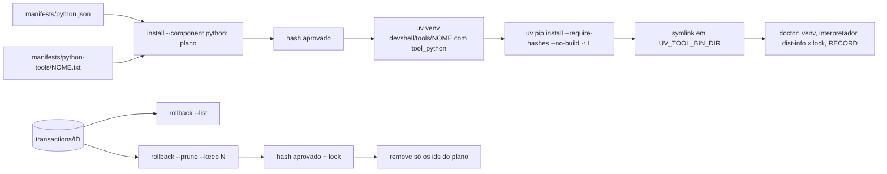

# Spec: histórico de transações, CI agendado, lock das ferramentas uv, setup simplificado e retirada de órfãos

## Contexto

A CLI `devshell` aplica dotfiles com journal e backup em
`$XDG_STATE_HOME/devshell/transactions/ID`, mas não mostra o histórico e nunca
apaga backups, que guardam cópias privadas dos dotfiles originais. A matriz de
containers e o smoke online só rodam por disparo manual. As ferramentas
Python (`manifests/python.json`) fixam a versão raiz, mas as dependências
transitivas são resolvidas a cada instalação, lacuna admitida em
`docs/SECURITY.md`. Público: quem mantém e usa o Data Lab em Linux.

Fatos observados (2026-11-09):

- Transações locais: 13, todas `committed`, numa cadeia linear por
  `previous_latest`, 144 KiB. Os manifestos têm `files`, `previous_latest`,
  `previous_registry` e `status`, sem data de criação.
- `uv tool install` (0.13.5) ignora os hashes de `--constraints` e de
  `--with-requirements`, mesmo com `UV_REQUIRE_HASHES=1` (Q-001, teste offline).
  `uv pip install --require-hashes -r LOCK` recusa hash errado e dependência
  ausente do lock; `uv pip sync --require-hashes` recusa hash errado, mas
  instala sem a dependência ausente.
- O uv grava o caminho da venv nos executáveis: a venv não pode ser montada num
  diretório temporário e renomeada depois.
- Hoje ruff, pre-commit e ipython estão em `~/.local/share/uv/tools`, com
  symlinks em `~/.local/bin`; o mesmo `uv tool` guarda outras ferramentas do
  usuário, fora do Data Lab.
- GitHub Actions: `schedule` usa cron POSIX em UTC, roda só na branch padrão,
  é desativado após 60 dias sem atividade em repositório público, e a
  notificação de falha vai para quem modificou o cron por último.

## Requisitos

**Histórico e poda de transações**

### R-001 Listar transações
- Enunciado: `devshell rollback --list` mostra todas as transações registradas.
- Critério: Dada uma HOME temporária com três aplicações seguidas e um rollback,
  Quando `rollback --list --json` roda, Então cada transação aparece com `id`,
  `status`, número de arquivos, `created` (ou `null` nas antigas) e posição na
  cadeia a partir de `latest` (`0` para a atual, `null` fora da cadeia), com
  saída 0. Sem transações, a saída é 0 com lista vazia. Nenhum arquivo ou
  diretório é criado (conferido com `find "$HOME"` antes e depois). Uma
  entrada inválida (diretório sem manifesto, manifesto ilegível, nome fora do
  padrão, symlink, temporário `.devshell-*`) aparece com `status: "invalida"`
  e o motivo, sem abortar a listagem.
- Prioridade: alta
- Estado: verificado
- Evidência: tests/history.bats::R-001 lista transações com status, cadeia e sem criar estado; tests/history.bats::R-001 entrada inválida aparece na listagem sem abortar; tests/history.bats::R-001 listagem marca symlink, nome inválido e temporário

### R-002 Data de criação nas novas transações
- Enunciado: transações novas registram a criação em UTC, ISO 8601.
- Critério: Dado um `apply` aprovado, Quando o manifesto é lido, Então contém
  `created` com fuso `Z`; manifestos antigos sem o campo continuam aceitos por
  `rollback`, `rollback --list` e `doctor`.
- Prioridade: média
- Estado: verificado
- Evidência: tests/history.bats::R-002 transação nova registra created em UTC; tests/history.bats::R-002 manifesto antigo sem created continua aceito; tests/history.bats::R-002 doctor aceita manifesto antigo sem created

### R-003 Plano de poda sem escrita
- Enunciado: `devshell rollback --prune --keep N` sem `--approve` mostra o
  plano e o hash de aprovação, sem alterar nada.
- Critério: Dadas cinco transações, Quando `rollback --prune --keep 2 --json`
  roda, Então lista três `delete` e duas `keep`, o total de bytes e `approval`
  (64 hex), avisa quando uma `delete` é a primeira transação da cadeia (a que
  guarda os dotfiles de antes do primeiro `apply`), com saída 0 e árvore de estado idêntica antes e depois (hash de
  todos os arquivos). `--keep` ausente, não inteiro ou menor que 1, `--keep`
  sem `--prune` e `--list` com `--prune` ou `--approve` saem com 2.
- Prioridade: alta
- Estado: verificado
- Evidência: tests/history.bats::R-003 plano de poda não altera o estado e avisa sobre os originais; tests/history.bats::R-003 combinações inválidas de opções saem com 2; tests/history.bats::R-003 dry-run descarta a aprovação; tests/history.bats::R-003 sem transação atual o plano avisa que remove todas

### R-004 Seleção conservadora
- Enunciado: a poda mantém `latest` e os N-1 antecessores na cadeia e marca
  para remoção as demais transações, inclusive as fora da cadeia.
- Critério: Dada uma transação com status fora de `committed`, `rolled-back`
  e `failed-restored` (inclusive `pending` e `rolling-back`), um manifesto
  ausente ou ilegível, um nome que não seja 32 hex, um symlink, ou um item que
  não seja `manifest.json` ou backup numerado regular dentro de uma transação,
  Quando a poda é planejada, Então sai com 2, nada é marcado e a mensagem
  aponta o procedimento manual do SECURITY. `latest` nunca é marcada.
- Prioridade: alta
- Estado: verificado
- Evidência: tests/history.bats::R-004 transação interrompida ou status desconhecido bloqueiam a poda; tests/history.bats::R-004 interrompida fora da cadeia não sugere rollback; tests/history.bats::R-004 entradas inválidas bloqueiam a poda sem alterar o estado; tests/test_boundaries.py::TransactionHistory.test_r004_pruning_never_follows_symlink_inside_transaction

### R-005 Poda aprovada
- Enunciado: com `--approve HASH`, a CLI replaneja sob o lock e remove só os
  diretórios do plano.
- Critério: Dado o hash do plano, Quando a poda roda, Então os diretórios
  `delete` deixam de existir, os `keep` e os demais arquivos de estado ficam
  byte a byte iguais, e a saída é 0. Com hash divergente ou estado alterado
  entre plano e execução, sai com 2 sem remover nada. Sob o lock, cada
  `delete`, da mais antiga para a mais nova, é renomeada para
  `devshell/pruning/ID` antes de ter o conteúdo removido, sem seguir symlinks.
  Dada uma falha injetada no meio, `transactions/` só contém transações
  inteiras, `rollback` e `apply` continuam funcionando, e a poda seguinte
  conclui a limpeza de `pruning/`.
- Prioridade: alta
- Estado: verificado
- Evidência: tests/history.bats::R-005 poda aprovada remove só o plano e preserva o restante; tests/history.bats::R-005 aprovação vencida não remove nada; tests/test_boundaries.py::TransactionHistory.test_r005_interrupted_prune_leaves_only_whole_transactions

### R-006 Rollback após poda
- Enunciado: desfazer a transação mais antiga mantida não deixa `latest`
  apontando para uma transação podada.
- Critério: Dada uma poda com `--keep 1`, Quando `rollback --approve HASH`
  restaura a transação mantida, Então `latest` deixa de existir (o anterior só
  vira `latest` se tiver `manifest.json` legível), o próximo
  `rollback` responde "Nenhuma transação para restaurar." com saída 0, e
  `apply` seguinte funciona.
- Prioridade: alta
- Estado: verificado
- Evidência: tests/history.bats::R-006 rollback da última transação mantida limpa latest e apply segue; tests/test_boundaries.py::TransactionHistory.test_r006_rollback_does_not_point_latest_to_unreadable_manifest

**CI agendado**

### R-010 Execução semanal completa
- Enunciado: o workflow `Verificações` roda toda semana com a mesma cobertura
  do disparo manual.
- Critério: Dado o workflow na `main`, Quando o evento `schedule` dispara
  (segunda 09:17 UTC), Então rodam `checks` com os cenários opcionais e a
  exigência de zero skips, os cinco `containers` e `online-smoke`. Verificação
  local: um teste lê `.github/workflows/ci.yml` como texto e confere o `cron` e
  que toda condição `workflow_dispatch` também aceita `schedule`. Verificação
  remota: a primeira execução agendada ou um disparo manual após o merge.
- Prioridade: média
- Estado: implementado
- Evidência: tests/test_ci_workflow.py::WeeklyWorkflow (local); a mesma cobertura passou por disparo manual no [workflow_dispatch 43185525822](https://github.com/talesgomes27/data-lab-dotfiles/actions/runs/43185525822); a primeira execução agendada na `main` (segunda 2026-11-16, 09:17 UTC) segue pendente

**Lock das ferramentas uv**

### R-020 Lock com hash por ferramenta
- Enunciado: cada ferramenta de `manifests/python.json` tem
  `manifests/python-tools/NOME.txt` com todas as dependências fixadas por `==`
  e ao menos um `--hash=sha256:`, incluindo a própria ferramenta na versão do
  manifesto.
- Critério: Dado o perfil `science` e um arquivo ausente, um requisito sem
  `==`, sem hash sha256, ou a versão da ferramenta diferente da do manifesto,
  Quando `install --component python` planeja, Então sai com 2 e nada é
  instalado. O leitor junta continuações com `\`, ignora comentários e linhas
  vazias, e guarda o marcador de ambiente (`; ...`) sem avaliá-lo. Sem
  `python-tools` nos componentes, nenhum lock é exigido.
- Prioridade: alta
- Estado: verificado
- Evidência: tests/test_boundaries.py::PythonToolLocks.test_r020_reads_continuations_comments_markers_and_normalizes_names; tests/test_boundaries.py::PythonToolLocks.test_r020_refuses_invalid_or_mismatched_locks; manifests/python-tools/ruff.txt; suíte completa sem skips, matriz e smoke online no [workflow_dispatch 43185525822](https://github.com/talesgomes27/data-lab-dotfiles/actions/runs/43185525822) (T-900)

### R-021 Instalação com hash obrigatório
- Enunciado: `install --component python` cria, para cada ferramenta, uma venv
  própria em `$XDG_DATA_HOME/devshell/tools/NOME` com o CPython gerenciado de
  `tool_python`, instala o lock com `uv pip install --require-hashes --no-build
  -r LOCK` e liga `$UV_TOOL_BIN_DIR/NOME` à `bin/NOME` da venv por symlink.
  Os comandos apontam a venv por `--python`, rodam sem `VIRTUAL_ENV`,
  `CONDA_PREFIX` e variáveis `UV_*` do usuário além dos diretórios do Data Lab,
  e não baixam interpretador.
- Critério: Dado o plano, Quando é exibido, Então mostra os comandos `uv venv`
  e `uv pip install` com o lock e a flag `--require-hashes`, o diretório da
  venv e o symlink; o hash de aprovação muda quando o lock muda. Dada uma
  instalação aprovada num ambiente de teste, a ferramenta executa pelo symlink
  e repetir a instalação não altera nada; uma venv ativa de outro projeto sai
  intacta. Com `python-tools` nos componentes, `check()`, `setup` e `doctor`
  exigem o uv 0.13.5 ou superior.
- Prioridade: alta
- Estado: verificado
- Evidência: tests/setup.bats::R-021 instalação preserva venv ativa de outro projeto e não chama uv tool; tests/setup.bats::R-021 repetir a instalação conforme não chama o uv para as ferramentas; tests/install.bats; fluxo com uv real no smoke online do [workflow_dispatch 43185525822](https://github.com/talesgomes27/data-lab-dotfiles/actions/runs/43185525822) (T-900)

### R-022 Hash divergente ou dependência fora do lock recusados
- Enunciado: a instalação falha sem deixar ferramenta parcial quando um hash
  diverge ou uma dependência não está no lock.
- Critério: Dados dois wheels locais construídos no teste, A dependendo de B,
  servidos offline com `--find-links`, Quando o lock tem o hash de B errado, ou
  não tem B, Então `uv pip install --require-hashes` falha, a venv criada nesta
  execução é removida, nenhum symlink é criado e a saída é 2; com o lock
  correto, A executa pelo symlink. Verificação em dois níveis: o comportamento
  do uv com wheels reais offline (T-201) e o da CLI com uv simulado (T-205); o
  fluxo da CLI com uv real só roda com rede, no smoke (R-024).
- Prioridade: alta
- Estado: verificado
- Evidência: tests/uv_constraints.bats (uv real, offline); tests/test_boundaries.py::PythonToolLocks.test_r022_mode_fix_failure_removes_created_venv; tests/setup.bats::R-022 falha do uv pip install remove só a venv criada e sai com 2 (uv simulado); tests/setup.bats::R-022 falha na terceira ferramenta lista as concluídas e mantém as anteriores; suíte completa sem skips, matriz e smoke online no [workflow_dispatch 43185525822](https://github.com/talesgomes27/data-lab-dotfiles/actions/runs/43185525822) (T-900)

### R-023 Doctor confere a ferramenta contra o lock
- Enunciado: `doctor` confere a venv, o interpretador, as distribuições
  instaladas e o symlink de cada ferramenta, sem executá-la.
- Critério: Dado um ambiente de ferramenta com uma distribuição em versão
  diferente do lock, uma distribuição ausente do lock, uma linha do lock sem
  marcador e sem distribuição instalada, um interpretador diferente de
  `tool_python`, ou um symlink que aponte para fora da venv, Quando
  `doctor --profile science` roda, Então há diagnóstico com o nome da
  ferramenta e saída 3. Nomes são comparados normalizados (PEP 503); linhas com
  marcador sem distribuição instalada não geram alerta. O hash do executável e
  dos módulos essenciais continua conferido pelo RECORD.
- Prioridade: alta
- Estado: verificado
- Evidência: tests/setup.bats (oito testes R-023 do doctor, inclusive link para fora da venv e interpretador fora do CPython gerenciado); tests/test_boundaries.py::PythonToolLocks.test_r023_unsafe_managed_python_points_to_interpreter_not_venv e test_r023_unsafe_managed_python_is_manual_in_doctor (D-020); suíte completa sem skips, matriz e smoke online no [workflow_dispatch 43185525822](https://github.com/talesgomes27/data-lab-dotfiles/actions/runs/43185525822) (T-900)

### R-024 Smoke online com lock
- Enunciado: o smoke online instala as ferramentas pelo fluxo com hash.
- Critério: Dado `scripts/online-smoke.sh` no CI, Quando roda, Então ruff,
  pre-commit e ipython instalam com `--require-hashes`, executam pelo symlink e
  a saída de `doctor --profile science` não aponta nenhuma ferramenta; o Ruff
  de `scripts/ci-setup.sh` também é instalado com o lock e `--require-hashes`.
- Prioridade: média
- Estado: verificado
- Evidência: scripts/online-smoke.sh no workflow_dispatch 42638571515 (sucesso); scripts/ci-setup.sh no job checks da mesma execução (sucesso)

### R-025 Migração explícita das instalações antigas
- Enunciado: a CLI não remove nem substitui instalações que não criou.
- Critério: Dado `$UV_TOOL_BIN_DIR/NOME` que não seja o symlink da venv do Data
  Lab (por exemplo o do `uv tool`), ou `devshell/tools/NOME` existente e
  divergente do lock, Quando `install --component python` planeja, Então sai
  com 2, nada é alterado e a mensagem traz o comando manual (`uv tool uninstall
  NOME`, ou revisar e mover o diretório). O mesmo bloqueio aparece em `setup
  --dry-run` e antes de qualquer comando administrativo do `setup`. Outras
  ferramentas do `uv tool` continuam intactas e a CLI não chama `uv tool`.
- Prioridade: alta
- Estado: verificado
- Evidência: tests/setup.bats::R-025 instalação do uv tool bloqueia setup e install sem alterar nada; tests/setup.bats::R-025 dry-run mostra conflito do uv tool mesmo com reparo de permissão pendente; tests/setup.bats::R-025 setup science repara permissão de grupo antes de avaliar as ferramentas; tests/test_boundaries.py::PythonToolLocks.test_r025_states_absent_orphan_link_conflict_and_divergent; suíte completa sem skips, matriz e smoke online no [workflow_dispatch 43185525822](https://github.com/talesgomes27/data-lab-dotfiles/actions/runs/43185525822) (T-900)

**Setup simplificado (Bloco D)**

Contexto: depois do Bloco C, atualizar a HOME exigiu `install --component
python` com hash copiado, `plan`/`apply` com a lista de perfis decorada e um
`chmod` manual. O `setup` já coordena os comandos com confirmações, mas não
lembra os perfis, pergunta por componente mesmo sem nada a fazer e não oferece
a correção dos modos das venvs. O caminho comum passa a ser `git pull` seguido
de `./bin/devshell setup`; os comandos individuais não mudam.

### R-040 Perfis lembrados
- Enunciado: depois de um `apply` concluído, a CLI guarda os perfis usados; um
  comando sem `--profile` usa os perfis guardados.
- Critério: Dado `apply --profile personal,science` concluído, Quando
  `setup`, `plan`, `doctor`, `diff`, `status` ou `install` rodam sem
  `--profile`, Então usam `personal,science`, e a saída mostra os perfis e a
  origem (`lembrados`, `informados` ou `padrão`). Com `--profile`, vale o
  informado, sem gravar nada até o próximo `apply`. Sem registro, vale
  `minimal`, exceto quando `~/.config/devshell/components` já tem componentes
  além dos de `minimal`: aí os comandos sem `--profile` saem com 2 pedindo
  `setup --profile ...` uma vez, para não rebaixar uma HOME já aplicada. Um
  `apply` sem arquivos a alterar também grava o registro. `plan`, `doctor`,
  `diff`, `status` e `--dry-run` não gravam o registro. `rollback` restaura os
  perfis guardados antes da transação. `project`, `install --component
  devshell` e `rollback` não dependem do registro; com `--profile` informado,
  um registro inválido só gera aviso.
- Prioridade: alta
- Estado: verificado
- Evidência: tests/profiles.bats (14 testes R-040); tests/test_boundaries.py::RememberedProfiles (inclui test_r040_unsafe_record_refuses_apply_without_creating_transaction, test_r040_rollback_without_previous_profiles_ignores_unsafe_record e test_r040_apply_without_changes_replans_under_lock); suíte completa sem skips, matriz e smoke online no [workflow_dispatch 43185525822](https://github.com/talesgomes27/data-lab-dotfiles/actions/runs/43185525822) (T-900)

### R-041 Resumo do setup antes da primeira confirmação
- Enunciado: o `setup` mostra, antes de qualquer pergunta, o que vai fazer.
- Critério: Dado um ambiente com reparos de permissão, pacotes nativos,
  componentes a instalar, ferramentas a migrar e dotfiles a atualizar, Quando
  `setup` roda, Então a primeira saída é um resumo com uma linha por etapa
  (quantidade e o que muda) e os bloqueios; com tudo em dia, o resumo diz
  "nada a fazer" e o setup termina com 0 sem perguntas. `setup --dry-run --json`
  traz o mesmo resumo num campo `summary`.
- Prioridade: alta
- Estado: verificado
- Evidência: tests/setup.bats (três testes R-041 do resumo); suíte completa sem skips, matriz e smoke online no [workflow_dispatch 43185525822](https://github.com/talesgomes27/data-lab-dotfiles/actions/runs/43185525822) (T-900)

### R-042 Componente sem nada a fazer não pede confirmação
- Enunciado: o `setup` só pergunta pelos componentes cujo plano prevê escrita.
- Critério: Dado um componente já instalado e conforme (binários e plugins com
  o mesmo hash do manifesto; Python com interpretadores presentes e ferramentas
  `conforme`), Quando `setup` roda, Então não há pergunta nem chamada de
  instalação para ele, e o resumo o lista como "em dia".
- Prioridade: média
- Estado: verificado
- Evidência: tests/setup.bats (testes R-042 de pending e da atualização do projeto); suíte completa sem skips, matriz e smoke online no [workflow_dispatch 43185525822](https://github.com/talesgomes27/data-lab-dotfiles/actions/runs/43185525822) (T-900)

### R-043 Correção segura dos modos das venvs do Data Lab
- Enunciado: o `setup` oferece tirar a escrita de grupo e outros dos arquivos
  dentro de `devshell/tools/NOME`, com confirmação própria.
- Critério: Dada uma venv do Data Lab com arquivos 664 (cache do uv com umask
  002), Quando `setup` roda, Então o resumo e a revisão de permissões listam a
  correção, que só é aplicada depois do `s`, por descritor, sem seguir
  symlinks e conferindo a identidade de cada arquivo; depois dela o `doctor`
  não aponta a ferramenta. Fora de `devshell/tools`, nada muda. A remoção da
  escrita feita na instalação (Bloco C) também passa a ser por descritor.
- Prioridade: alta
- Estado: verificado
- Evidência: tests/setup.bats (três testes R-043); tests/test_setup.py::PermissionReview.test_r043_venv_mode_items_ignore_symlinks_and_refuse_swaps; suíte completa sem skips, matriz e smoke online no [workflow_dispatch 43185525822](https://github.com/talesgomes27/data-lab-dotfiles/actions/runs/43185525822) (T-900)

### R-044 Doctor indica o próximo passo
- Enunciado: com pendências, o `doctor` termina com o comando a rodar.
- Critério: Dado um `doctor` com pendências que o `setup` resolve (componente
  ausente, dotfile desatualizado, ferramenta ausente ou com modos inseguros),
  Quando roda, Então a última linha é "Próximo passo: ./bin/devshell setup" (com
  `--profile` só se os perfis não forem os lembrados) e o JSON traz
  `next_step` com `command` e `reason`; com pendência manual (conflito do `uv
  tool`, extensão Zsh insegura, arquivo `.zwc`), o próximo passo é a ação
  manual da mensagem; sem pendências, `next_step` é `null`.
- Prioridade: alta
- Estado: verificado
- Evidência: tests/test_boundaries.py::DoctorNextStep (inclui test_r044_informed_profiles_equal_to_remembered_omit_profile); tests/setup.bats (dois testes R-044); suíte completa sem skips, matriz e smoke online no [workflow_dispatch 43185525822](https://github.com/talesgomes27/data-lab-dotfiles/actions/runs/43185525822) (T-900)

### R-045 Documentação do caminho comum
- Enunciado: README e INSTALLATION abrem com o caminho comum de instalar e
  atualizar e mantêm os comandos individuais numa seção avançada.
- Critério: Dado o diff final, Quando revisado, Então "Atualizar" tem dois
  comandos (`git pull` e `./bin/devshell setup`), com saída de exemplo
  executada em HOME temporária, e a seção avançada mantém plan/apply/install/
  rollback com hash; CHANGELOG avisa da mudança do perfil padrão.
- Prioridade: média
- Estado: verificado
- Evidência: README.md (Atualizar); docs/INSTALLATION.md (Atualizar configuração e versões); CHANGELOG.md; revisão de documentação do T-900 (docs/VALIDATION.md)

### R-046 Perfis lembrados não encolhem a HOME aplicada
- Enunciado: um registro de perfis que não corresponde ao que está aplicado
  não pode tirar componentes em silêncio.
- Critério: Dado `~/.config/devshell/components` com componentes que os perfis
  lembrados não geram, Quando um comando roda sem `--profile`, Então sai com 2
  antes de qualquer plano, lista os componentes que sairiam e pede `setup
  --profile ...` uma vez, sem gravar nada. Com `--profile` informado, vale o
  informado. Perfis lembrados que só acrescentam componentes seguem normalmente.
- Prioridade: alta
- Estado: implementado
- Evidência: tests/profiles.bats (2 testes R-046)

**Retirada de arquivos órfãos (Bloco E)**

Contexto: o registro `$XDG_STATE_HOME/devshell/current.json` só cresce. O
`apply` grava `registro anterior | arquivos escritos` e nunca tira uma
entrada. Quem troca `personal` por `minimal` fica com `nushell/config.nu`,
`nushell/env.nu`, `starship.toml` e `direnv/lib/devshell-python.sh` no disco e
no registro, sem aviso no `plan` nem no `doctor` (observado em 2026-11-12 numa
HOME temporária). Um dotfile removido ou renomeado no repositório também fica,
mas sai do universo: pela D-024 ele só deixa o registro (`forget-outside`) e a
remoção do arquivo é manual. É o item 1 do [ROADMAP](ROADMAP.md), com o escopo reduzido pela
D-022.

Termos: **órfão** é uma entrada do registro cujo caminho não está em
`desired_files()` dos perfis atuais. **Universo** é
`desired_files(all_components=True)`: todos os alvos que alguma combinação de
componentes deste checkout pode gerar, o mesmo conjunto que o rollback já usa
como escopo.

### R-050 Plano mostra os órfãos sem gravar
- Enunciado: `plan`, `status`, `diff` e `doctor` listam os órfãos e o que o
  próximo `apply` faria com cada um.
- Critério: Dado um registro com caminhos fora dos perfis atuais, Quando
  `plan` roda, Então cada órfão aparece com uma ação:
  - `remove`: está no universo, é arquivo regular do usuário com link único,
    em caminho seguro, e o SHA-256 atual é igual ao registrado;
  - `forget-edited`: o conteúdo atual difere do registrado (D-023);
  - `forget-missing`: o arquivo não existe mais;
  - `forget-outside`: fora do universo, por exemplo dotfile removido do
    repositório ou `XDG_CONFIG_HOME` trocado (D-024);
  - `forget-unsafe`: no universo, mas inseguro: qualquer motivo de
    `path_issues` (symlink no caminho ou em ancestral, outro dono, permissões,
    caminho inválido), hardlink, tipo não regular ou `PermissionError` na
    leitura.

  A classificação segue esta ordem, e a primeira que vale decide:
  `forget-outside` → `forget-unsafe` → `forget-missing` → `forget-edited` →
  `remove`. O teste de universo compara o texto exato da chave com as chaves de
  `desired_files(all_components=True)` antes de qualquer `stat` ou leitura, de
  modo que um registro adulterado não faz a CLI tocar caminhos fora do
  universo. Nenhum caso lança exceção. A lista entra no hash de aprovação com
  caminho, ação, motivo e, nos `remove`, o snapshot completo; o JSON ganha o
  campo `retire`. O `diff` em texto mostra cada `remove` como diff unificado
  para vazio; conteúdo que não é UTF-8 aparece como "(conteúdo binário)".
  Nenhum desses comandos grava nada (AGENTS.md).
- Prioridade: alta
- Estado: proposto

### R-051 Apply retira na mesma transação
- Enunciado: o `apply` aprovado remove os órfãos `remove` e tira do registro
  todos os órfãos, dentro da transação que já existe.
- Critério: Dado um plano aprovado com órfãos, Quando `apply --approve HASH`
  roda, Então, sob o lock, a CLI replaneja e confere o hash. Para cada
  `remove`, copia o arquivo para a transação e confere que o SHA-256 do backup
  é igual ao do `before`. Depois abre o diretório pai sem seguir symlinks,
  confere a identidade (`st_dev`, `st_ino`) do pai e do arquivo e o snapshot, e
  remove com `dir_fd`. A entrada vai para a lista do caminho de falha logo
  depois da remoção. O `current.json` final não tem nenhum órfão. Um plano só
  com órfãos, sem arquivos a escrever, também abre uma transação; só com
  `forget-*`, a transação tem `files: []`. Uma transação sem escrita não
  executa o Chezmoi. Se algo falha no meio, os arquivos já removidos voltam do
  backup e o registro anterior é restaurado, como numa escrita que falha. Diretórios que ficarem vazios não
  são removidos (D-025). Arquivos `forget-*` nunca são tocados.
- Prioridade: alta
- Estado: proposto

### R-052 Rollback devolve o que foi retirado
- Enunciado: o `rollback` da transação recoloca os arquivos removidos e o
  registro anterior.
- Critério: Dado um `apply` que removeu órfãos, Quando `rollback` aprovado
  roda, Então cada arquivo volta com o conteúdo, o modo e o dono do backup, e
  `current.json` volta ao anterior, inclusive as entradas `forget-*`. Se o
  caminho de um arquivo removido foi recriado e editado depois do `apply`, o
  rollback recusa, como já faz com arquivo editado. Se o dotfile de um
  `remove` saiu do repositório depois do `apply`, o rollback recusa a
  transação (o caminho saiu do universo) com uma mensagem que aponta o backup
  em `transactions/ID` para a recuperação manual. O rollback de uma transação
  só com `forget-*` devolve as entradas ao registro. A poda (`rollback
  --prune`) trata essas transações como as outras e avisa quando remove a única
  cópia de um arquivo retirado.
- Prioridade: alta
- Estado: proposto

### R-053 Doctor e setup tratam órfãos como pendência do setup
- Enunciado: o `doctor` acusa os órfãos, e o `setup` os resolve na etapa de
  aplicação.
- Critério: Dado um registro com órfãos, Quando `doctor` roda, Então cada
  órfão gera um diagnóstico `arquivo gerenciado fora dos perfis: CAMINHO
  (AÇÃO)`, saída 3 e `next_step` `setup` (D-019). O resumo do `setup` conta os
  órfãos na etapa de aplicação e nunca a marca `em dia` com órfãos, nem só com
  `forget-*`. A etapa de aplicação considera os órfãos (R-042): um plano só com
  órfãos pergunta "Aplicar os dotfiles…", e a pergunta "Registrar os perfis…"
  nunca aparece nem aprova o hash quando `retire` não está vazio. A pergunta de
  confirmação diz quantos arquivos serão removidos e quantos só saem do
  registro. Os órfãos do universo entram na revisão de permissões do setup
  (D-027). Depois do `setup`, o `doctor` não
  acusa mais órfãos.
- Prioridade: média
- Estado: proposto

### R-055 Registro válido
- Enunciado: um `current.json` com formato inválido é recusado antes de
  qualquer classificação.
- Critério: Dado um `current.json` que não é objeto JSON, ou que tem chave que
  não é caminho absoluto em texto, ou valor que não é SHA-256 (64 hexadecimais
  minúsculos), Quando qualquer comando lê o registro, Então sai com 2 e uma
  mensagem que aponta o arquivo, sem traceback e sem gravar nada.
- Prioridade: alta
- Estado: proposto

### R-054 Documentação da retirada
- Enunciado: README, USAGE, SECURITY e CHANGELOG explicam que trocar de perfil
  retira os arquivos que ficaram de fora, o que é preservado e como desfazer.
- Critério: Dado o diff final, Quando revisado, Então a USAGE tem um exemplo
  executado de troca de perfil com retirada, a tabela de recuperação do
  SECURITY inclui "arquivo retirado", com dois limites: o rollback recusa a
  transação se o dotfile saiu do repositório, e a poda pode remover a única
  cópia de um arquivo retirado. A SECURITY também lembra que, num perfil
  aplicado com `--replace-existing`, o original do usuário está só na
  transação daquele apply. A USAGE avisa que um `XDG_CONFIG_HOME` diferente
  numa sessão faz os caminhos antigos virarem `forget-outside`. O CHANGELOG
  marca a mudança de comportamento do `apply`.
- Prioridade: média
- Estado: proposto

**Documentação**

### R-030 Documentação fiel
- Enunciado: USAGE, SECURITY, ARCHITECTURE, CONTRIBUTING, CHANGELOG e
  VALIDATION descrevem os comandos, a irreversibilidade da poda, o
  agendamento e o lock, com os limites.
- Critério: Dado o diff final, Quando revisado, Então cada flag nova aparece em
  `devshell --help` e na USAGE com exemplo executado, a tabela de recuperação
  do SECURITY inclui a poda, CONTRIBUTING traz o comando de regeneração do lock
  e o ADR 004 registra D-007/D-008.
- Prioridade: média
- Estado: verificado
- Evidência: bin/devshell --help (--list, --prune --keep); docs/USAGE.md (rollback --list, --prune --keep, next_step), exemplos executados em HOME temporária sem criar estado; docs/SECURITY.md (Histórico e poda de backups, tabela de recuperação); CONTRIBUTING.md (regeneração do lock); docs/ADR/004-lock-ferramentas-uv.md (D-007, D-008)

## Fora do escopo

### N-001 Poda de `launcher-backups`, `permission-repairs`, `manual-backups` e `user-config-backups`
### N-002 Poda automática ou por idade, sem aprovação
### N-003 Reinstalação automática, `--force` ou remoção pela CLI de ferramentas fora do lock ou instaladas pelo `uv tool`
### N-004 Lock do próprio uv, do Chezmoi ou do Nushell (já fixados por SHA-256 em `artifacts.json`)
### N-005 Revisão assistida de manifestos, Quarto, desinstalação e Git gerenciado (itens 5 a 9 da conversa)
### N-006 Alerta por canal além da notificação padrão do GitHub
### N-007 `git pull`, atualização do checkout ou verificação de versões nova pela CLI
### N-008 `--yes` ou aprovação automática no setup
### N-009 Migrações declarativas, desinstalação e mudança da D-013 (itens 4 a 6 da proposta)

### N-010 Manifesto de migrações declarativas (`manifests/migrations.json`): sem caso que o registro não cubra (D-022)
### N-011 Migração automática das instalações pelo `uv tool` (a D-013 continua manual)
### N-012 Remoção de diretórios vazios, do launcher, das ferramentas, dos plugins ou da fonte
### N-013 Remoção de arquivo fora do universo ou editado, mesmo com `--replace-existing`

## Decisões

### D-001 Flags no comando `rollback`
`--list` e `--prune --keep N` ficam em `rollback`, que já é dono do journal.
`bin/devshell` aceita `--list`, `--prune` e `--keep` só em `rollback`. Evita
um subcomando novo e reaproveita `latest_transaction`, `locked` e `safe_path`
de `lib/state.py`.

### D-002 `--keep` obrigatório
Sem valor padrão: a quantidade a manter é escolha explícita, porque a poda é
irreversível. `latest` é sempre mantida, então `--keep 1` é o mínimo.

### D-003 Hash de aprovação da poda
O hash cobre o conteúdo de `latest`, o valor de N e, para cada transação, id,
status, decisão (`keep`/`delete`) e o SHA-256 e tamanho de cada arquivo. Qualquer mudança entre plano e
execução invalida a aprovação, como em `apply` e `rollback`.

### D-004 Rollback na borda do histórico
Em `rollback`, `latest` só passa a `previous_latest` se essa transação tiver
`manifest.json` legível; senão `latest` é removido. Não reescreve manifestos (o journal não é editado).

### D-009 Poda por renomeação
Cada transação a remover sai primeiro de `transactions/` por `os.rename` para
`devshell/pruning/ID`, no mesmo sistema de arquivos, e só então tem o conteúdo
apagado com `dir_fd` e `O_NOFOLLOW`. Uma interrupção deixa resto apenas em
`pruning/`, que nenhum leitor do journal consulta e que a poda seguinte limpa.

### D-010 Piso do uv acompanha a prova
Com `python-tools` nos componentes, `check()` e `VERSION_FLOORS` (usado por
`setup` e `doctor`) exigem o uv na versão em que Q-001 e R-022 foram provados
(0.13.5), porque a verificação de hash depende dele.

### D-005 `created` opcional
Novos manifestos ganham `created`; leitores tratam ausência como `null`. O
campo não entra no hash do plano de `apply`.

### D-006 Cron semanal fora da hora cheia
`17 9 * * 1` (segunda, 09:17 UTC, 06:17 em Brasília), longe do início da hora,
quando o GitHub atrasa ou descarta execuções. As condições dos jobs passam a
`github.event_name == 'workflow_dispatch' || github.event_name == 'schedule'`.

### D-007 Um lock com hash por ferramenta
Gerado na revisão de manifesto com `uv --no-config pip compile --universal
--python-version 3.13 --generate-hashes --index-url https://pypi.org/simple
--no-python-downloads` a partir de `NOME==VERSÃO`, e versionado em
`manifests/python-tools/`. `--python-version` é o `tool_python` de
`manifests/python.json` em minor. Um arquivo por ferramenta evita conflito de
dependências entre elas.

### D-008 Venv própria com `uv pip install --require-hashes` (adotada)
O `uv tool install` não aplica hashes (Q-001). Cada ferramenta vira uma venv
criada por `uv venv --managed-python --python TOOL_PYTHON` e preenchida por
`uv pip install --require-hashes --no-build -r LOCK`. `install -r` foi
escolhido sobre `sync` porque recusa dependência ausente do lock. O destino
é sempre `--python VENV/bin/python`, com `--link-mode copy` para a venv não ter
hardlinks no cache do uv, `--no-python-downloads` e `--offline` no modo
offline. A venv é dedicada; distribuições extras aparecem no doctor.

### D-011 Local e executáveis
As venvs ficam em `$XDG_DATA_HOME/devshell/tools/NOME`, fora do registro do
`uv tool`. O executável é um symlink em `$UV_TOOL_BIN_DIR` (o mesmo diretório
que as shells já põem no PATH) para `bin/NOME` da venv, como o `uv tool` faz.

### D-012 Falha não deixa ferramenta parcial
A instalação roda num helper Python sob `fs.locked()`, que reclassifica cada
ferramenta (ausente, conforme, divergente) antes de criar algo. A venv nasce no
destino final, porque o uv grava o caminho nos executáveis: o diretório é
criado com `os.mkdir` exclusivo, o que marca que a CLI o criou nesta execução,
e só então o `uv venv` roda nele. Se o `uv pip install` falhar, a CLI remove
essa venv com `shutil.rmtree` (que no Linux não segue symlinks), não cria o
symlink e sai com 2; as ferramentas anteriores do mesmo plano ficam e o
relatório diz quais. O symlink é criado com `os.symlink`, que falha se algo
já existe. Uma interrupção por sinal deixa uma venv parcial, que a execução
seguinte trata como divergente e bloqueia para revisão manual.

### D-013 Migração manual
Instalações anteriores feitas pelo `uv tool` bloqueiam o plano com o comando
`uv tool uninstall NOME`. A CLI não chama `uv tool`, para não afetar outras
ferramentas do usuário. O ADR 003 passa a apontar o ADR 004 para as CLI Python.

### D-014 Perfis em arquivo de estado próprio
Os perfis ficam em `$XDG_STATE_HOME/devshell/profiles`, numa forma canônica
(sem duplicatas, sem o `minimal` implícito, na ordem informada), validada
como em `resolve_profiles`. Não vão para `~/.config/devshell/components`, que
o Nushell lê inteiro. Num `apply` com arquivos a alterar, o registro é gravado
na transação, depois de `current.json`, e o manifesto guarda
`previous_profiles` (texto ou `null`); o caminho de falha e o `rollback` o
restauram (`null` remove o registro; manifesto antigo sem a chave deixa o
registro como está e o rollback avisa "perfis anteriores desconhecidos; informe
--profile"). Num `apply` sem arquivos a alterar e sem órfãos (Bloco E), o registro é
gravado sob `locked()` por escrita atômica, sem transação. O registro nunca é um item de
`transactions/ID`, o que preserva a poda e o `--list` do Bloco A.

### D-015 Precedência: informado, lembrado, `minimal`
Vale para `setup`, `plan`, `apply`, `update`, `diff`, `status`, `doctor` e
`install` (menos `--component devshell`). `project`, `install --component
devshell` e `rollback` não leem o registro; a guarda de `project` passa a
olhar se `--profile` foi informado. A leitura é feita por um helper Python de
`state.py`, com o mesmo `xdg()` da gravação e sem `mkdir`; ela confere o próprio
arquivo (regular, do usuário, sem symlink nem hardlink) mas não os ancestrais,
para um `~/.local` com escrita de grupo não impedir o `setup` de oferecer o
reparo. A gravação continua com `safe_path`.

Revisão na execução (2026-11-09): a ordem informada é mantida, em vez da ordem
de `profiles/`, porque reordenar mudaria a ordem dos componentes e reescreveria
`~/.config/devshell/components` de quem já aplicou; `personal,science` e
`science,personal` são seleções distintas no hash. Num `apply` sem arquivos a
alterar pelo `setup`, o registro dos perfis tem confirmação própria. Sem
`--profile`, um registro inválido sai com 2 e a mensagem pede `--profile`;
com `--profile`, vira aviso. A origem (`lembrados`, `informados` ou
`padrão`) vai em `profile_source`, fora do hash de aprovação, como `created`.
Sem registro e com `components` além de `minimal`, a origem é `desconhecida`
e os comandos sem `--profile` saem com 2 (R-040).

### D-016 Resumo como previsão das inspeções existentes
O resumo de R-041 vem de `setup inspect` e dos planos de `install` e `plan`,
sem estado novo e sem rede. Etapas que dependem do reparo de permissões
(Python, versões) aparecem como "reavaliado depois do reparo". Cada etapa
recalcula o próprio plano antes da sua pergunta; não há confirmação global, e o
resumo diz que cada etapa pede a sua.

### D-017 `pending` por componente
`pending` entra no plano de `install`, fora do hash de aprovação. Por
componente: `pyinit`, hash do destino e bit de execução; `plugins` e
`firacode`, os checksums `health` de `artifacts.json` (a mesma conferência do
doctor, um subconjunto dos arquivos, registrado como limite); `uv`, `chezmoi` e
`nu`, que já ficam fora de `user_components` quando presentes; `python`,
interpretadores do manifesto presentes em `UV_PYTHON_INSTALL_DIR` e todas as
ferramentas `conforme`. O `setup` só pergunta quando `pending` é verdadeiro.

### D-018 Modos das venvs na revisão de permissões do setup
A revisão ganha uma categoria própria: arquivos regulares e diretórios com
escrita de grupo ou outros dentro de `devshell/tools/NOME` com `pyvenv.cfg`
regular, obtidos por `os.walk` sem seguir symlinks; symlinks da venv são
ignorados, não recusados, e os itens não passam pelas checagens de hardlink e
dono de `target_paths`. O texto agrupa por venv (quantidade e exemplos) e o JSON
mantém a identidade de cada item. O reparo usa `repair_permission`, que abre
com `O_NOFOLLOW` no último componente e confere a identidade antes do `fchmod`;
a instalação passa a usar uma função equivalente em `state.py`, sem importar
`setup` (evita ciclo). A mensagem do doctor para esse caso é própria ("modos
inseguros na venv; o setup corrige"), distinta de uma venv divergente.

### D-019 Regras do próximo passo
Um `next_step` só: se houver pendência manual, a primeira delas; senão, se
houver pendência que o `setup` resolve, o `setup` (com `--profile` só quando a
origem não é `lembrados`); senão, `null`. Um doctor que sai com 2 não emite
`next_step`. Invariante testada: depois de um `setup` que diz "nada a fazer",
o doctor nunca sugere `setup`. A classificação é uma tabela de padrões das
mensagens, com teste por tipo; ficam como ação manual, por escolha, a
integridade divergente de um componente e o interpretador uv divergente (a
reinstalação não remove o que diverge), `permissões inseguras` fora das venvs
(o reparo do setup não cobre todo caminho que o doctor confere) e o componente
que está em `~/.local/bin` fora do PATH da sessão (abrir uma shell nova
resolve). O doctor deixou de acusar `arquivo gerenciado divergente` quando o
arquivo já é igual ao desejado e só o registro em `current.json` difere: o
apply seguinte reescreve o registro, e acusar levaria a um setup sem nada a
fazer; `next_step` entra no CHANGELOG como campo novo
do JSON.

### D-020 CPython gerenciado inseguro é ação manual sobre o interpretador
Interpretador e `patchlevel.h` ficam em `UV_PYTHON_INSTALL_DIR`, fora da venv.
Se um deles, ou um ancestral, tem caminho inseguro (escrita de grupo/outros,
dono inesperado, symlink), a ferramenta continua `divergente` e bloqueante,
mas a mensagem aponta o diretório do CPython e, para modos, `chmod -R go-w`
nele, sem pedir para mover a venv. No doctor, o interpretador aparece como
`interpretador uv com caminho inseguro`, ação manual. O setup não corrige esses
modos: o diretório é do uv e pode servir outros projetos, fora do escopo
restrito das escritas. Achado P2 da revisão do T-900.

### D-021 Registro de perfis conferido contra os componentes aplicados
Em 2026-11-12, uma HOME aplicada com `personal,science,extras` tinha o registro
`minimal`, e o `setup` propôs, como um diff comum, tirar 24 componentes de
`components`; a mudança foi aplicada. A origem do registro não foi apurada: não
há transação entre 2026-11-09 e 2026-11-12 que o explique. Depois de
`resolve_profiles`, quando a origem é `lembrados`, `state.py profiles-check`
compara o `components` aplicado com os componentes dos perfis lembrados e sai
com 2 se algum sairia. Só a remoção bloqueia: uma versão nova que acrescenta
componente a um perfil segue o caminho comum. Uma versão que tira componente
de um perfil também passa a pedir `--profile` uma vez; é o custo aceito, porque
encolher a HOME precisa ser uma escolha explícita.

### D-022 O registro é a fonte da retirada, sem manifesto de migrações
O registro já diz o que a CLI escreveu e com que conteúdo. Arquivo renomeado no
repositório equivale a "o antigo fica órfão e o novo é escrito". No histórico
do repositório não houve migração de dotfile que precisasse de mais do que
isso. A única migração real, a D-013, mexe num ambiente externo sem desfazer e
continua manual. Um manifesto (N-010) só entra quando houver um caso concreto.
Decidido pelo usuário em 2026-11-12.

### D-023 Órfão editado é preservado e sai do registro
Se o SHA-256 atual difere do registrado, o conteúdo é do usuário: o arquivo
fica intacto, a entrada sai do registro e o plano avisa. Não há flag para
removê-lo (N-013). Decidido pelo usuário em 2026-11-12.

### D-024 Só o universo pode ser removido
Remover só caminhos de `desired_files(all_components=True)` mantém a retirada
dentro do escopo que o rollback já aceita (`rollback_plan` recusa caminhos fora
dele). Um registro adulterado não consegue apontar a remoção para fora dos
alvos que o checkout pode gerar. O que está fora, como um dotfile removido do
repositório ou um `XDG_CONFIG_HOME` antigo, é preservado e sai do registro com
aviso para remoção manual.

### D-025 Diretórios ficam
Diretórios vazios depois da retirada não são removidos, como já diz a tabela de
recuperação do SECURITY ("diretórios criados podem permanecer vazios").
Remover diretórios exigiria saber quais a CLI criou, o que o journal não
registra.

### D-026 Formato no journal
Cada `remove` entra em `files` do manifesto da transação com `action:
remove`, `before` (snapshot), `after: null`, `backup` e, depois da remoção,
`applied: null`. Assim `restore_entry` e `rollback_plan` funcionam sem mudança
de formato. As entradas `forget-*` vão para um campo `forgotten`, só para
relatório; o registro anterior já fica em `previous_registry`. Manifestos
antigos, sem esses campos, continuam aceitos.

### D-027 Órfãos do universo na revisão de permissões do setup
Um ancestral com escrita de grupo transformaria o órfão em `forget-unsafe`, e a
entrada sairia do registro sem que o arquivo pudesse ser removido depois.
Para evitar isso, `target_paths` inclui os órfãos que estão no universo. O
setup oferece o reparo antes da etapa de aplicação, e o plano é recalculado
depois. Fora do setup, `forget-unsafe` é definitivo: a entrada sai do registro
e o arquivo fica para remoção manual. Achado P2 da revisão do plano.

## Restrições

- `rollback --list`, o plano de poda e `--dry-run` não criam estado (AGENTS.md).
- Poda e lock seguem aprovação por hash, sem `--yes`, e o `setup` não as aciona.
- Testes em HOME/XDG/cache temporários, sem rede; o que exige rede fica no
  smoke online ou na matriz.
- Atualizar versões ou hashes é revisão de manifesto com fonte oficial (PyPI).

## Questões abertas

### Q-001 O `uv tool install` aplica os hashes do arquivo de constraints?
Respondida em 2026-11-09 por T-201 (`tests/uv_constraints.bats`, offline, uv
0.13.5): não. Com o hash da dependência transitiva errado, `uv tool install`
instalou com `--constraints`, com `UV_REQUIRE_HASHES=1` e com
`--with-requirements`; só `uv pip install --require-hashes` numa venv recusou
("Hash mismatch"). Pela D-008, o Bloco C parou e o desenho volta ao usuário.

### Q-002 Todas as dependências têm wheel para x86_64 e aarch64, glibc e musl?
Resolvida ao gerar os arquivos (T-202), conferindo os hashes do lock contra os
wheels de cada combinação de `manifests/artifacts.json`; sem wheel para alguma,
`--no-build` falharia ali e a decisão volta ao usuário. Respondida em 2026-11-09 por
T-202: os três locks resolvem com `--no-build` e hash obrigatório em
x86_64/aarch64 com glibc e musl (resolução, não execução nessas plataformas).

### Q-004 O perfil padrão sem `--profile` pode passar a ser o lembrado em todos os comandos?
Hoje é `minimal`. Scripts que chamam a CLI sem `--profile` passariam a usar os
perfis aplicados (D-015). A alternativa é lembrar só no `setup`. Respondida em
2026-11-09 pelo aceite do desenho do Bloco D: vale em todos os comandos (D-015).

### Q-003 A notificação semanal para quem editou o cron por último atende?
Por padrão, você recebe; se outra pessoa editar o cron, passa a ser ela.
Respondida em 2026-11-12 pelo usuário: atende. Com um mantenedor só, fica o
padrão do GitHub e a N-006 continua valendo. Se outra pessoa passar a editar o
workflow, reabrir e avaliar uma issue aberta por um job de falha do `schedule`,
com `issues: write` só nesse job. A desativação após 60 dias sem atividade não
gera falha e fica fora desse alerta.
